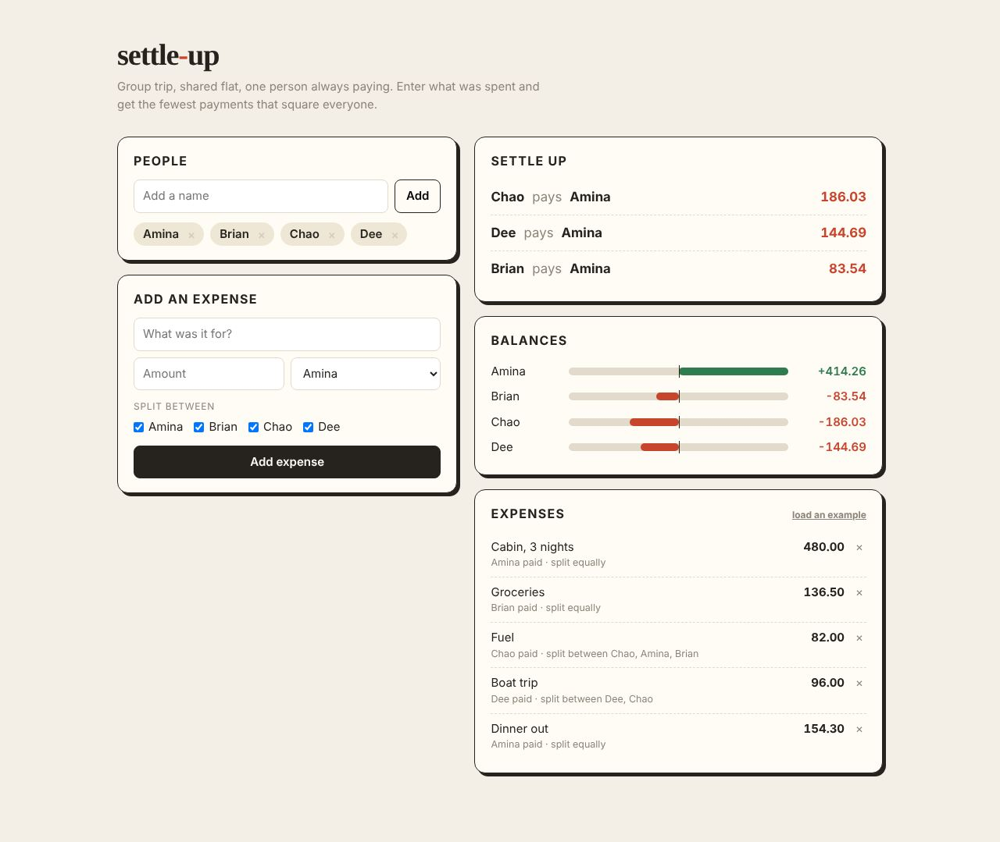

# settle-up

After a trip or in a shared flat, one person ends up paying for everything. Enter the expenses and get the fewest payments that square everyone.

**Live:** https://sammy1-com.github.io/settle-up/

Plain HTML, CSS and JS. Open `index.html`, no build step.

Works in whole cents so nothing drifts. Matching the biggest debtor with the biggest creditor needs at most n-1 payments for n people. Data stays in localStorage.
